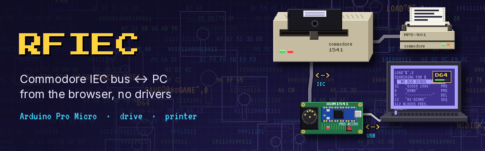

<p align="center"></p>

<p align="center">
<a href="README.md">English</a> · <b>Italiano</b>
</p>

# RFIEC

**RFIEC** è un firmware per l'**Arduino Pro Micro** (ATmega32U4) che collega il PC al **bus seriale IEC
Commodore** e si comanda tutto **da una pagina web**, attraverso Web Serial: niente driver, niente programmi da
installare.

Usa la stessa scheda e gli stessi fili della **XUM1541 "PROMICRO"** e funziona nei due sensi:

| Modo | Cosa succede | Pagina |
|---|---|---|
| **Il PC fa da drive** | Il C64 vede il PC come **drive 8** (o 9, 10, 11): `LOAD"$",8`, `LOAD`, `SAVE`, comandi DOS, immagini D64/D71/D81. Funzionano Final Cartridge III ed Epyx FastLoad. | [retrofixer.it/xum1541](https://retrofixer.it/xum1541/) → *Il PC fa da drive* |
| **Il PC fa da stampante** | Il C64 stampa sul numero **4** (o 5) e la pagina disegna il foglio riga per riga come una MPS-801/803; si scarica in **PDF**. | [retrofixer.it/stampante-commodore](https://retrofixer.it/stampante-commodore/) → *Il C64 stampa sul PC* |
| **Drive vero** | Il PC comanda un 1541/1571/1581 vero: directory, disco → D64, D64 → disco, file singoli, comandi DOS, formattazione. | [retrofixer.it/xum1541](https://retrofixer.it/xum1541/) → *Drive reale* → **Collega la RFIEC** |
| **Stampante vera** | Il PC stampa testi e immagini su una stampante Commodore MPS vera. | [retrofixer.it/stampante-commodore](https://retrofixer.it/stampante-commodore/) → *Stampante vera* |

Il DOS, le immagini dei dischi e la stampante emulata girano **nel browser**: il firmware si occupa solo dei tempi
del bus e passa ogni evento al PC via USB.

## Hardware

Un **Arduino Pro Micro 5 V / 16 MHz** e un cavo o una presa **DIN a 6 poli** per il bus IEC, cablati come la XUM1541
"PROMICRO", senza altri componenti: se hai già costruito quell'adattatore cambi solo il firmware. Lo schema è
nel [README inglese](README.md#hardware).

| Pro Micro | Porta | Segnale | Pin DIN IEC |
|---|---|---|---|
| 16 | PB2 | DATA | 5 |
| 14 | PB3 | CLK | 4 |
| 8 | PB4 | ATN | 3 |
| 9 | PB5 | SRQ | 1 |
| 10 | PB6 | RESET | 6 |
| GND | – | GND | 2 |

La versione della XUM1541 con l'integrato **7406** non è supportata da RFIEC.

## Installare il firmware

**Dalla pagina** (il modo più semplice): apri [retrofixer.it/xum1541](https://retrofixer.it/xum1541/) con Chrome,
Edge o Firefox 151 o successivi, premi **Firmware del Pro Micro…**, scegli **RFIEC**, premi **Installa**, fai il
**doppio reset** del Pro Micro (tocca due volte di seguito RST con GND) e scegli la porta del bootloader. Il
bootloader resta sempre al suo posto: puoi tornare alla XUM1541 quando vuoi.

**Con avrdude**: scarica `rfiec-v2.6.hex` dalle [release](https://github.com/zeus074/RFIEC/releases/latest), fai il
doppio reset e lancia

```
avrdude -p m32u4 -c avr109 -P COM7 -b 57600 -D -U flash:w:rfiec-v2.6.hex:i
```

oppure, su Windows, `tools\flash-promicro.ps1`.

## RFIEC o XUM1541?

Stessa scheda, due firmware. RFIEC in più fa da drive e da stampante per il C64 e non vuole driver; la XUM1541
serve per **OpenCBM, cbmXfer, d64copy** e gli altri programmi per PC, che RFIEC non vede (usa un suo protocollo su
porta seriale). Si passa dall'uno all'altro dalla stessa pagina in un minuto.

## Compilare

```
cd firmware
arduino-cli compile --fqbn arduino:avr:leonardo --libraries libraries ^
  --build-property "build.usb_product=\"RFIEC\"" --output-dir build rfiec
```

## Stato

Provato su hardware vero (novembre 2026): C64 con `LOAD`/`SAVE`, Final Cartridge III ed Epyx FastLoad; 1541-II
come drive vero; MPS-801 come stampante vera. Da provare: C64 con kernal **JiffyDOS**.

## Licenza

GPL-3.0. Usa la libreria [IECDevice](https://github.com/dhansel/IECDevice) di David Hansel (GPL-3.0). I tempi della
modalità padrone del bus seguono la XUM1541 di OpenCBM, senza usarne il codice. Pagine web:
[retrofixer.it](https://retrofixer.it).
