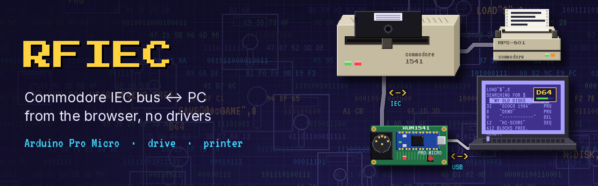
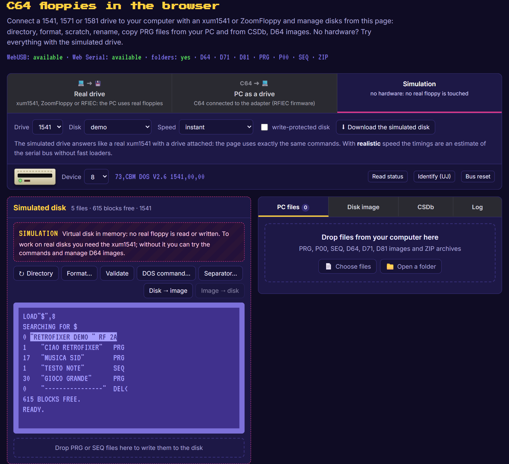
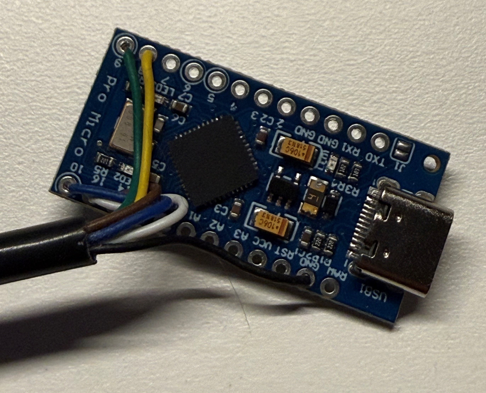
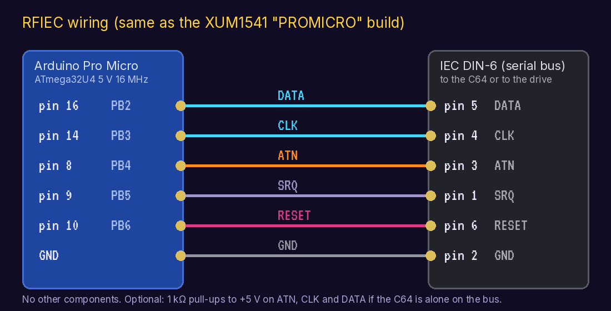
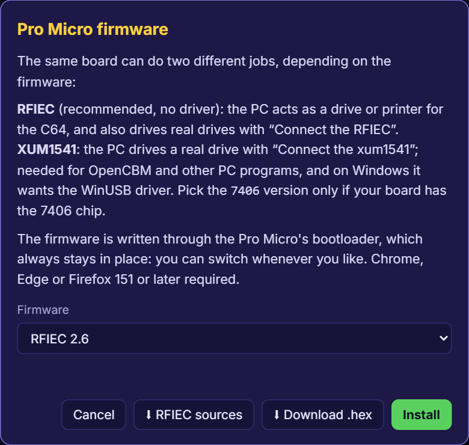
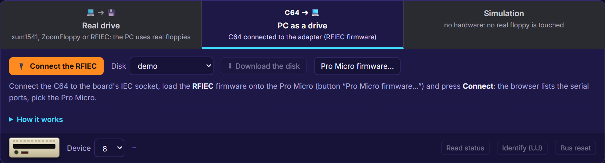
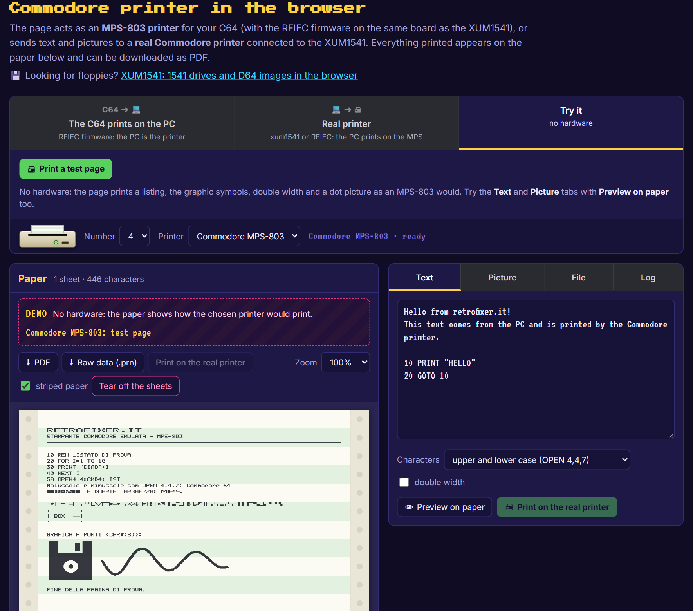
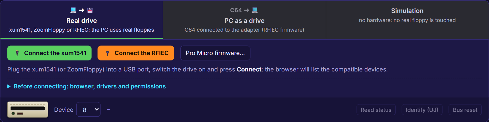
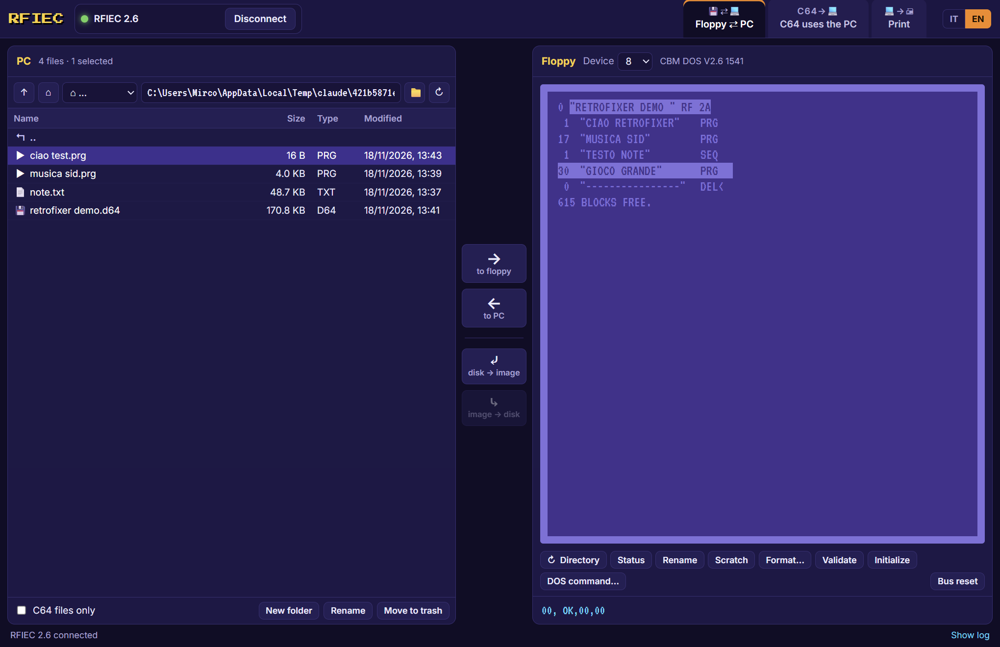

<p align="center"></p>

<p align="center">
<b>English</b> · <a href="README.it.md">Italiano</a>
</p>

# RFIEC

**RFIEC** is a firmware for the **Arduino Pro Micro** (ATmega32U4) that connects a PC to the
**Commodore IEC serial bus** and is driven entirely **from a web page**, through Web Serial.
No drivers, no programs to install.

It runs on the same board and wiring as the popular **XUM1541 "PROMICRO"** build, and it works in both
directions:

| Mode | What happens | Web page |
|---|---|---|
| **PC as a drive** | The C64 sees the PC as **drive 8** (or 9, 10, 11): `LOAD"$",8`, `LOAD`, `SAVE`, DOS commands, D64/D71/D81 images. Final Cartridge III and Epyx FastLoad work. | [retrofixer.it/xum1541](https://retrofixer.it/xum1541/) → *PC as a drive* |
| **PC as a printer** | The C64 prints to device **4** (or 5) and the page draws the sheet line by line like an MPS-801/803; download it as **PDF**. | [retrofixer.it/stampante-commodore](https://retrofixer.it/stampante-commodore/) → *The C64 prints on the PC* |
| **Real drive** | The PC controls a real 1541/1571/1581: directory, disk → D64, D64 → disk, single files, DOS commands, format. | [retrofixer.it/xum1541](https://retrofixer.it/xum1541/) → *Real drive* → **Connect the RFIEC** |
| **Real printer** | The PC prints text and pictures on a real Commodore MPS printer. | [retrofixer.it/stampante-commodore](https://retrofixer.it/stampante-commodore/) → *Real printer* |

The DOS, the disk images and the printer emulation run **in the browser**: the firmware only handles the
bus timing and forwards every bus event over USB.

<p align="center"></p>

## Contents

- [Hardware](#hardware)
- [Install the firmware](#install-the-firmware)
- [Use it](#use-it)
- [Desktop program](#desktop-program-windows-linux-macos)
- [RFIEC or XUM1541?](#rfiec-or-xum1541)
- [Build from source](#build-from-source)
- [How it works](#how-it-works)
- [Status and limits](#status-and-limits)
- [Credits and license](#credits-and-license)

## Hardware

An **Arduino Pro Micro 5 V / 16 MHz** (ATmega32U4) and a **6-pin DIN** cable or socket for the IEC bus.
The wiring is exactly the XUM1541 "PROMICRO" one, with no other components: if you already built that
adapter, you only change the firmware.

<p align="center"><br><sub>A finished RFIEC: the IEC cable is soldered straight to the Pro Micro pins, nothing else on the board.</sub></p>

<p align="center"></p>

| Pro Micro | Port | Signal | IEC DIN pin |
|---|---|---|---|
| 16 | PB2 | DATA | 5 |
| 14 | PB3 | CLK | 4 |
| 8 | PB4 | ATN | 3 |
| 9 | PB5 | SRQ | 1 |
| 10 | PB6 | RESET | 6 |
| GND | – | GND | 2 |

> The XUM1541 version with the **7406** line driver chip is **not** supported by RFIEC: use the direct wiring.

## Install the firmware

### From the web page (easiest)

1. Open [retrofixer.it/xum1541](https://retrofixer.it/xum1541/) with **Chrome, Edge or Firefox 151+**.
2. Press **Pro Micro firmware…** and choose **RFIEC**.
3. Press **Install**, then **double-reset** the Pro Micro (touch RST to GND twice, quickly): the LED pulses
   slowly and the Caterina bootloader stays active for about 8 seconds.
4. Choose the bootloader port in the browser list. The page writes and verifies the firmware.

<p align="center"></p>

The bootloader is never touched, so you can go back to the XUM1541 firmware from the same dialog at any time.

### With avrdude

Download `rfiec-v2.6.hex` from the [latest release](https://github.com/zeus074/RFIEC/releases/latest)
(or from [`hex/`](hex/)), double-reset the board and run:

```
avrdude -p m32u4 -c avr109 -P COM7 -b 57600 -D -U flash:w:rfiec-v2.6.hex:i
```

On Windows, [`tools/flash-promicro.ps1`](tools/flash-promicro.ps1) waits for the bootloader port and runs the
avrdude that comes with the Arduino IDE:

```
powershell -ExecutionPolicy Bypass -File tools\flash-promicro.ps1
```

## Use it

After flashing, the board shows up as a serial port called **RFIEC**.

**C64 → PC (the PC is the drive or the printer)**

1. Connect the board to the C64 serial port (or in the chain with a drive switched off).
2. On [the drive page](https://retrofixer.it/xum1541/) open **PC as a drive**, pick a disk image and press
   **Connect the RFIEC**, then choose *RFIEC (COMx)*.
3. On the C64: `LOAD"$",8` and `LIST`.

<p align="center"></p>

For printing, open [the printer page](https://retrofixer.it/stampante-commodore/) → **The C64 prints on the PC**,
connect, and on the C64: `OPEN4,4:CMD4:LIST`.

<p align="center"></p>

**PC → real drive or printer**

On the drive page open **Real drive** and press the orange **Connect the RFIEC** button; on the printer page use
**Real printer**. Switch the drive or the printer on first.

<p align="center"></p>

Browsers: Web Serial is available in **Chrome**, **Edge** and **Firefox 151 or later** (Firefox asks for an extra
permission the first time). On Linux your user must be allowed to open serial ports (usually the `dialout` group).

## Desktop program (Windows, Linux, macOS)

**RFIEC** is also a desktop program in the style of cbmXfer. It shows PC folders on the left and the floppy directory
on the right, and copies files, disk images, DOS commands and formats. It also works the other way round: the C64
uses the PC as drive 8 and as printer 4, and whatever the C64 saves goes straight into the D64 file on the PC. It can
also print on a real Commodore printer. It works with the RFIEC (no driver) and with an xum1541, in Italian and English.

<p align="center"></p>

Download it from the [releases](https://github.com/zeus074/RFIEC/releases) (tags `desktop-v…`). Details, notes for
each system and how to build it are in [desktop/README.md](desktop/README.md).

## RFIEC or XUM1541?

Same board, two firmwares. Choose by what you need:

| | XUM1541 | RFIEC |
|---|---|---|
| PC reads/writes real floppies | ✅ | ✅ |
| PC prints on a real printer | ✅ | ✅ |
| C64 uses the PC as a drive | ❌ | ✅ |
| C64 prints on the PC (PDF) | ❌ | ✅ |
| Windows driver needed | WinUSB (Zadig) | none |
| Works with OpenCBM, cbmXfer, d64copy… | ✅ | ❌ |
| Copy speed with real drives | faster with OpenCBM's turbo transfers | standard serial bus (≈ 149 blocks in 92 s) |
| 7406 line-driver version | ✅ | ❌ |

RFIEC speaks its own protocol over a USB serial port, so **OpenCBM-based programs do not see it**. If you need
them, flash the XUM1541 firmware back from the same web page: it takes a minute.

## Build from source

The sketch is in [`firmware/rfiec/`](firmware/rfiec/) and needs the bundled copy of the
[IECDevice](https://github.com/dhansel/IECDevice) library in [`firmware/libraries/`](firmware/libraries/).
Board: **Arduino Leonardo** (`arduino:avr:leonardo`, same ATmega32U4 and Caterina bootloader as the Pro Micro).

With [arduino-cli](https://arduino.github.io/arduino-cli/):

```
cd firmware
arduino-cli compile --fqbn arduino:avr:leonardo --libraries libraries ^
  --build-property "build.usb_product=\"RFIEC\"" --output-dir build rfiec
```

`build.usb_product` makes the board show up as "RFIEC" instead of "Arduino Leonardo". Version 2.6 uses
17 736 bytes of flash (61 %) and 1 289 bytes of RAM.

In the Arduino IDE: copy `firmware/libraries/IECDevice` into your sketchbook `libraries` folder, open
`firmware/rfiec/rfiec.ino` and compile for *Arduino Leonardo*.

## How it works

- **Device mode** (default): the IECDevice library answers the C64 on the bus with the right timing
  (including the JiffyDOS, Final Cartridge III and Epyx FastLoad protocols). Every event – LISTEN, TALK, data
  bytes, UNLISTEN, UNTALK – goes to the browser, which runs the DOS on the disk image and sends back the data.
  Fast loaders are recognised by the web page (checksums of the `M-W` commands and the `M-E` address), which then
  tells the firmware to start the fast protocol.
- **Bus controller mode** (command `M 1`): the Pro Micro drives the bus like a C64 or an XUM1541 – ATN
  commands, data with EOI, reading from a talker, bus reset. The routines are written from scratch, with the
  timing of the XUM1541 in OpenCBM (75 µs CLK low before each bit, 20 µs bit valid).

The serial protocol is described in [docs/PROTOCOL.md](docs/PROTOCOL.md) and at the top of
[`rfiec.ino`](firmware/rfiec/rfiec.ino).

## Status and limits

Tested on real hardware (November 2026): C64 with `LOAD`/`SAVE`, Final Cartridge III and Epyx FastLoad;
1541-II as a real drive (status, directory, read and write); MPS-801 as a real printer.

- Not tested yet: a C64 with a **JiffyDOS** kernal.
- The page must stay open while the C64 uses the PC as a drive or printer.
- Copy-protected originals cannot be duplicated with DOS commands (this is not a nibbler).
- If the C64 is alone on the bus and often reports `?DEVICE NOT PRESENT`, try 1 kΩ pull-ups to +5 V on ATN,
  CLK and DATA.

See [CHANGELOG.md](CHANGELOG.md) for the version history. Bug reports and pull requests are welcome.

## Credits and license

- **RFIEC** firmware by [RetroFixer](https://retrofixer.it) – GPL-3.0, see [LICENSE](LICENSE).
- [**IECDevice**](https://github.com/dhansel/IECDevice) by David Hansel (GPL-3.0): device-side bus timing and fast
  loader protocols. Bundled copy (source files only), unchanged except that JiffyDOS, Epyx FastLoad and Final Cartridge III support
  are enabled in `src/IECConfig.h`.
- The **XUM1541** firmware and the **OpenCBM** project (Nate Lawson and contributors, GPL-2.0+): the hardware this
  firmware shares and the reference timing for bus controller mode. No OpenCBM code is used.
- The web pages that drive RFIEC are part of [retrofixer.it](https://retrofixer.it).
