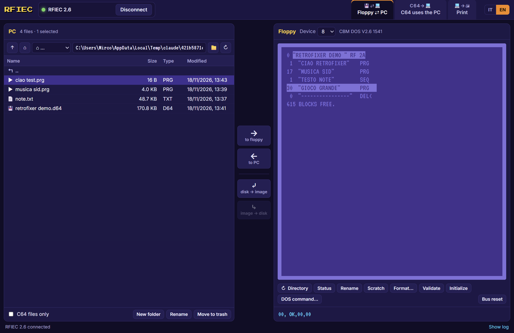

# RFIEC – desktop program

A program for **Windows, Linux and macOS** that manages Commodore floppy drives and printers through the
**RFIEC** board (no driver) or an **xum1541 / ZoomFloppy**. Its two-pane layout is like cbmXfer, and it can also
work the other way round, with the C64 using the PC. Italian and English (switch at the top right or in *View*).

<p align="center"></p>

| Tab | What it does |
|---|---|
| **Floppy ⇄ PC** | PC folders on the left, the floppy directory on the right (1541, 1571, 1581). Copy files both ways with the arrows, Enter, a double-click or drag and drop (PRG, SEQ, USR, P00). Read a whole disk to D64/D71/D81, write an image back to a disk. Also status, rename, scratch, format, validate, initialize, DOS command and bus reset. Works with the RFIEC and the xum1541. |
| **C64 uses the PC** | The C64 sees the PC as **drive 8–11** with a D64/D71/D81 image from the PC folder, and as a **printer 4/5** (MPS-803, Epson FX or NEC P emulation). Whatever the C64 saves goes straight into the image file. The printout appears on paper and can be saved as PDF or raw `.prn`. RFIEC only. |
| **Print** | Prints text, or the listing of a BASIC program, on a real Commodore printer, with upper-case or lower-case characters. Can also send a file raw, such as a `.prn` saved earlier. |

The *Interface* menu also installs firmware on the Pro Micro: RFIEC, XUM1541 or XUM1541 with 7406. It goes through
the board's bootloader, so you can switch whenever you like.

## Download

Packages are attached to the releases tagged `desktop-v…`: <https://github.com/zeus074/RFIEC/releases>

| System | File | Notes |
|---|---|---|
| Windows 10/11 | `RFIEC-x.y.z-win-x64.exe` (installer) or `RFIEC-x.y.z-win-portable.exe` | The packages are not signed, so SmartScreen may warn you: choose *More info → Run anyway*. The xum1541 needs the WinUSB driver (Zadig); the RFIEC needs nothing. |
| Linux | `RFIEC-x.y.z-linux-x86_64.AppImage` or `.deb` | AppImage: `chmod +x` and run (on Ubuntu 22.04+ install `libfuse2`). To open serial ports your user must be in the `dialout` group (`sudo usermod -aG dialout $USER`, then log in again). The xum1541 needs a udev rule, as for OpenCBM. |
| macOS 11+ | `RFIEC-x.y.z-mac-arm64.dmg` (Apple Silicon) or `-x64.dmg` (Intel) | The app is not notarized: the first time, right-click → *Open*, or run `xattr -cr /Applications/RFIEC.app`. |

## Run from source

```
cd desktop
npm install
npm start
```

`npm run dist` builds the packages for your own system. GitHub Actions builds all three systems
(`.github/workflows/desktop.yml`).

## How it is made

- [Electron](https://www.electronjs.org/): Chromium provides **Web Serial** (RFIEC) and **WebUSB** (xum1541) on all
  three systems, so no native serial or USB library is needed.
- `app/index.html`, `app.js`, `app.css`, `i18n.js`: the program (interface and logic) and its Italian/English text.
- `app/lib/`: the protocol and format libraries shared with the [retrofixer.it](https://retrofixer.it/xum1541/) web
  pages. They cover the xum1541 and RFIEC protocols, the CBM DOS commands, D64/D71/D81 images, the emulated DOS for
  the C64, and the MPS/Epson/NEC printer emulation with PDF output. They are **copied** by `floppy-web/build.py`:
  do not edit them here.
- `main.js` / `preload.js`: access to the PC folders, settings, the menu, and the serial-port/USB-device chooser.

License: GPL-3.0-or-later.
